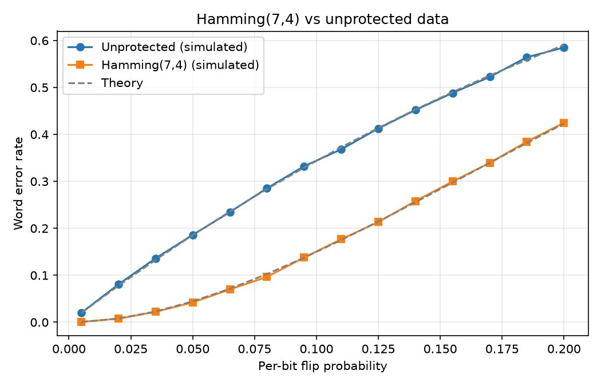

# Hamming(7,4) Error Correction and SEU Simulation

Python implementation of a Hamming(7,4) encoder and decoder, with a Monte Carlo
fault-injection framework that flips random bits (emulating single-event upsets)
and compares protected data against unprotected data.

**Status:** in progress

## Motivation
Bits stored or transmitted in electronics can be flipped by noise or radiation.
Error-correcting codes such as Hamming(7,4) detect and repair these flips. This
project builds the code from scratch and measures how much protection it gives.

## How it works
Four data bits are encoded into seven bits by adding three parity bits.

| Position | 1 | 2 | 3 | 4 | 5 | 6 | 7 |
|---|---|---|---|---|---|---|---|
| Bit | p1 | p2 | d1 | p3 | d2 | d3 | d4 |

- p1 = d1 ^ d2 ^ d4, p2 = d1 ^ d3 ^ d4, p3 = d2 ^ d3 ^ d4
- The decoder recomputes the three parity checks to form a 3-bit syndrome.
- A syndrome of 0 means no error is detected. Otherwise the syndrome is the
  position of the flipped bit, and flipping it back corrects the word.

## Project structure
- `src/hamming.py` - encode, syndrome, decode
- `src/fault_injection.py` - random bit flips
- `src/simulate.py` - Monte Carlo experiments, results table, plot
- `tests/test_hamming.py` - pytest tests (exhaustive for all 16 words)

## How to run
```
python -m venv .venv
source .venv/bin/activate        # Windows PowerShell: .venv\Scripts\Activate.ps1
pip install -r requirements.txt
pytest
python src/simulate.py
```

## Results
Run `python src/simulate.py`, then paste the generated table here.

<paste results/results_table.md>



## Limitations and future work
- Hamming(7,4) corrects only single-bit errors. Two or more errors are
  miscorrected.
- A SECDED extension (an extra overall parity bit, giving an (8,4) code) would
  correct single errors and detect double errors.
- This is a software simulation only, not a hardware test.